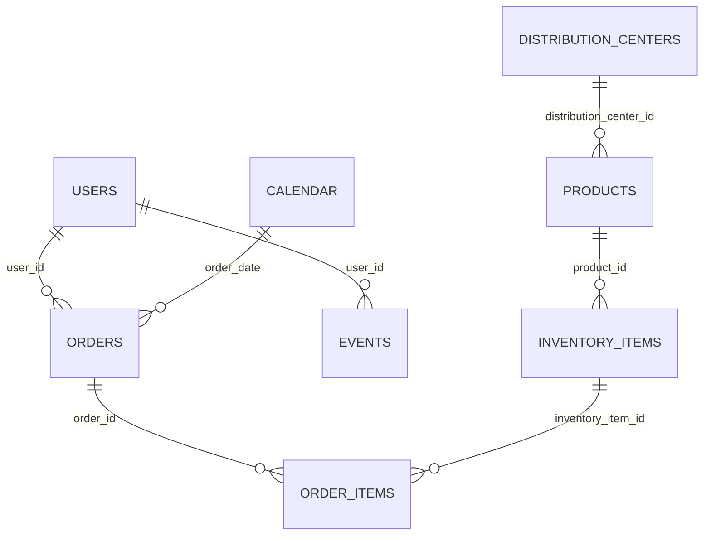

<div align="center">

# 🛍️ E-Commerce Data Analytics
### End-to-End Business Intelligence with Microsoft Excel

**From raw e-commerce data to decision-ready, interactive dashboards.**


**7 Data Tables · 2.43M+ Website Events · 4 Interactive Dashboards**

</div>

---

## 📌 Project Overview

This project explores **e-commerce performance across sales, orders, products, customers, inventory, and website activity**, using **Microsoft Excel only**.

Rather than building isolated charts, I developed an analytical workflow that combines **Power Query transformations, Power Pivot relationships, DAX measures, PivotTables, PivotCharts, and connected slicers** to answer real business questions.

**Core objectives**
- Evaluate sales, gross profit, and order fulfillment.
- Identify high-performing products, categories, and brands.
- Understand customer segments, repeat purchasing, and geographic patterns.
- Explore web traffic sources, event activity, browser behavior, and session-level purchase indicators.

## 🏠 Dashboard Home Page


The workbook includes a home page for navigating between four analytical dashboards.

---

## 📈 Business KPIs

The following values represent the **unfiltered model-level baseline** documented during analysis, not necessarily the values displayed in screenshots taken with active slicers.

| Metric | Value |
|:--|--:|
| Completed Sales | **$2,715,783.74** |
| Gross Profit | **$1,409,923.37** |
| Gross Profit Margin | **51.92%** |
| Total Orders | **125,226** |
| Completed Orders | **31,354** |
| Total Customers | **100,000** |
| Customers With Orders | **80,044** |
| Repeat Customers | **30,212** |
| Repeat Customer Rate | **37.74%** |
| Total Products | **29,120** |
| Completed Units | **45,609** |
| Website Events | **2,431,963** |
| Website Sessions | **681,759** |
| Session Purchase Rate | **26.66%** |

> **Metric definitions matter:** `Completed Sales` includes completed order-item sales, rather than every order. Filtered dashboard values depend on the slicers connected to each PivotTable. Figures shown in historical screenshots may therefore differ from these overall totals.

---

## 📊 Interactive Dashboards

### 01 · Executive Overview

A consolidated view of **revenue, profit, orders, and business performance**.


**Analysis covered:** revenue and profit KPIs, sales trends, top product categories, order status distribution, and a business summary.

### 02 · Sales & Products

Investigates **what sells, which brands contribute, and how revenue relates to profit**.


**Analysis covered:** monthly sales performance, top categories, top brands, best-selling products, and category-level pricing and profitability.

### 03 · Customers & Orders

Explores **who the customers are, how they purchase, and where demand comes from**.


**Analysis covered:** customer age segments, order statuses, top customers, gender distribution, geographic sales patterns, and repeat-purchase KPIs.

### 04 · Web & Funnel Analysis

Looks beyond transactions to understand **on-site events, visitor sources, and purchase-related engagement**.


**Analysis covered:** traffic sources, event types, browser performance, conversion-rate comparisons, top cities, source-versus-event breakdowns, and session purchase indicators.

> **Important analytical distinction:** Counts of product views, cart events, and purchase events are not equivalent to a true user-level conversion funnel. A step-by-step funnel needs to follow the same users or sessions across each stage.

---

## 🧰 Tools & Techniques

| Tool | Application |
|:--|:--|
| **Microsoft Excel** | Dashboard development and interactive reporting |
| **Power Query** | Data cleansing, transformations, and date preparation |
| **Power Pivot** | Relational modeling and table relationships |
| **DAX** | Reusable measures and business KPI definitions |
| **PivotTables & PivotCharts** | Aggregations and visual exploration |
| **Slicers** | Dynamic filtering across compatible PivotTables |

### Data preparation

- Corrected data types and standardized customer identifiers.
- Prepared dates for Calendar-to-Orders relationships.
- Reviewed missing values rather than substituting arbitrary dates.
- Built an Excel Data Model with related customer, product, order, inventory, and event tables.
- Created calculated measures for financial, operational, customer, and digital performance.

## 🗂️ Data Model

The analysis uses **seven source tables** plus a Calendar table for time intelligence.

| Table | Records | Purpose |
|:--|--:|:--|
| `users` | 100,000 | Customer profiles and demographics |
| `orders` | 125,226 | Orders, dates, and statuses |
| `order_items` | 181,759 | Sold items and sales prices |
| `products` | 29,120 | Categories, brands, and product details |
| `inventory_items` | 490,705 | Inventory, cost, and sold status |
| `events` | 2,431,963 | Website sessions and events |
| `distribution_centers` | 10 | Distribution center details |
| `Calendar` | — | Date filtering and time intelligence |

### Model relationships



## 🧮 Sample DAX Measures

**Completed Sales**
```dax
Completed Sales :=
CALCULATE(
    SUM(order_items[sale_price]),
    order_items[status] = "Complete"
)
```

**Completed Sales Cost**
```dax
Completed Sales Cost :=
CALCULATE(
    SUMX(order_items, RELATED(inventory_items[cost])),
    order_items[status] = "Complete"
)
```

**Gross Profit**
```dax
Gross Profit :=
[Completed Sales] - [Completed Sales Cost]
```

The model also includes **AOV, order completion and cancellation rates, customer retention, inventory sell-through, YTD sales, and year-over-year measures**.

---

## 🔎 Selected Analytical Observations

- The unfiltered analysis recorded approximately **$2.72M completed sales** and **$1.41M gross profit**.
- **80,044 customers** placed orders, and **30,212** are classified as repeat customers in the model.
- The dataset includes **308,946 unsold inventory units** with an estimated unsold inventory cost of **$8.85M**, providing a useful basis for stock-efficiency analysis.
- More than **2.43M website events** enable comparison of traffic sources, browsing behavior, and purchase-related activity.
- **2024 is a partial reporting period** in the dataset; full-year comparisons should take this limitation into account.

These are **descriptive findings**, not causal conclusions.

---

## ▶️ How to Use

1. Browse the dashboard screenshots above.
2. If the final `.xlsx` workbook is included in this repository, download it.
3. Open it in **Microsoft Excel desktop** with Power Pivot / Data Model support.
4. Navigate between the four dashboard sheets and use slicers to explore the visuals.
5. Refresh queries only if the original data-source files and paths are available.

**Note:** GitHub can display screenshot previews, but the Excel slicers and PivotCharts are interactive only inside the workbook.

## 📂 Repository Files

```text
Ecommerce-Data-Analytics-Excel/
├── README.md
├── home page.png
├── Excutive Overview.png
├── Sales&Products.png
├── Customers & Orders..png
├── Web & Funnel Analysis.png
└── [Excel workbook, if uploaded]
```

> **Image paths:** This README references the **five screenshot files in the repository root** using their original names (including spaces and punctuation). If the screenshots are stored inside a folder instead, update the five image paths accordingly. Do not rename one side without updating the other.

---

<div align="center">

**Built entirely in Microsoft Excel — driven by analytical thinking, not just charts.**

**Data Analytics · Power Query · Power Pivot · DAX · Data Modeling · Business Intelligence**

</div>
